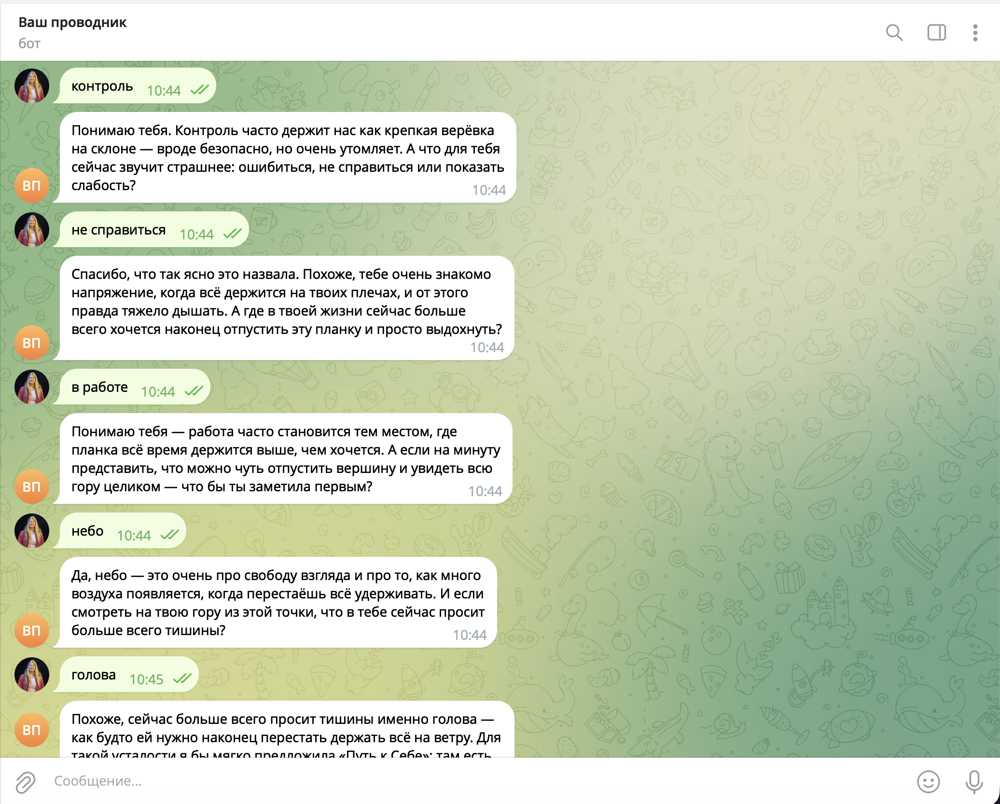
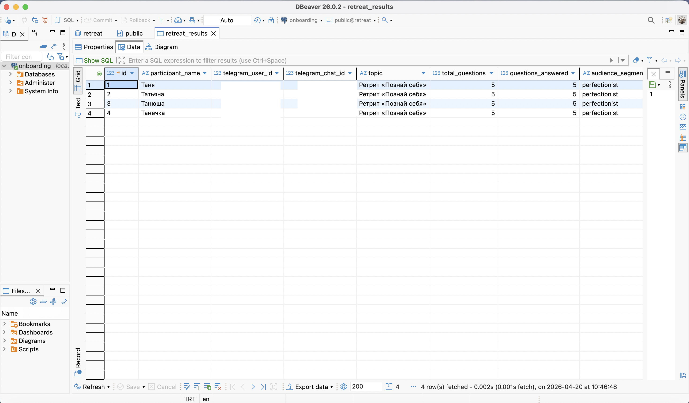
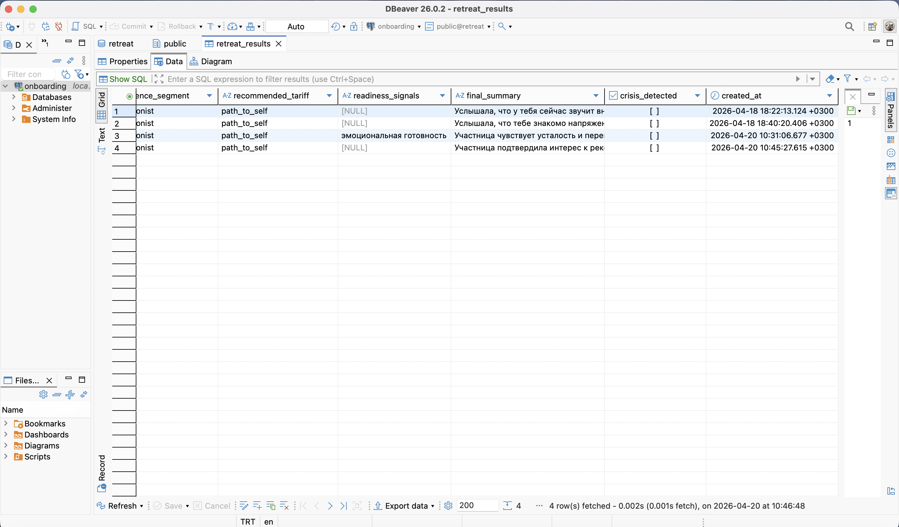

# Path to Self: an AI guide bot for a retreat

A Telegram bot for a women's retreat. It has a short conversation with a prospective guest about what brought her here, suggests one of three retreat formats and hands her over to Leya, a separate booking bot.

This is a practice project. The retreat, "Know Yourself" («Познай себя»), is a training scenario of a retreat center, not a real organization. The bot speaks Russian and English. Case study: [tatidzufri.com/en/case/path-to-self](https://tatidzufri.com/en/case/path-to-self).


## About the project

The bot handles the first and most delicate part of the funnel. It listens, asks a few reflective questions and explains why a particular format suits this guest. It doesn't discuss dates, venues or payment: that's Leya's job, a separate booking bot, `@retreat_poznai_bot`. The guest moves to her with one button in the chat.

After each conversation a short summary is saved to the database, so you can see which requests people come with and which formats resonate.

## The task

People come to a retreat with very different needs. One wants quiet and a chance to breathe out, another wants to talk to a psychologist, a third wants serious work with a coach. Show them three prices and a program right away, and many get lost and leave "to think about it". Going through each request by hand takes more time than an organizer has.

An emotional product doesn't sell well through a form. A person first needs to feel heard, and only then is ready to choose a format.

## How it works

1. **A conversation in phases.** Getting acquainted and hearing the request, reflection, choosing a format, saying goodbye with a handover to Leya. An OpenAI model writes the replies under a strict instruction, and the bot decides when it's time to move on.
2. **Three audience portraits.** "The tired perfectionist", "the mom who lost herself", "the creative seeker". The bot works out which one the guest is closest to and adapts its language and metaphors.
3. **Choosing a format.** Out of three formats (in English: Path to Self $390, Rhythm of Harmony $1,490, Your Own Summit $2,290) the bot suggests one and explains the choice in the guest's own words.
4. **Brand word filter.** If "guaranteed results" or "breakthrough" slips into a model reply, the bot softens the wording before sending.
5. **Stop on warning signs.** If the guest writes about self-harm or suicidal thoughts, the conversation stops and the bot sends contacts for psychological help. A retreat is not a replacement for therapy.
6. **A summary in the database.** Name, chosen format, portrait, "readiness signals" (asked about dates, mentioned payment) and a flag for a crisis case.

## What it looks like

**Start of the conversation.** The bot introduces itself and asks one open question about what brought the guest here.


**Reflective questions.** One at a time, with a short warm response to each answer.



**Summaries in the database.** The main conversation fields, then formats and outcomes.

| Main fields | Formats and outcomes |
|:-:|:-:|
|  |  |

## Results

- The bot runs the first qualification itself: the guest arrives at Leya with a recommended format.
- Every conversation leaves an anonymized summary that shows which requests and formats come up most.
- Retreat texts, audience portraits, the number of questions, banned words and the partner bot are changed in settings, without touching the code.

What's not there yet. The bot looks for warning signs with a list of marker words, so it can miss a veiled phrasing. The list should grow from real conversations.

## Tech stack

| Technology | What it's for |
|---|---|
| **Python 3.11** | Project language, convenient for Telegram bots and language models |
| **aiogram 3** | Telegram: messages, the "Cancel" and "Go to Leya" buttons, each guest's conversation step |
| **OpenAI API** | Writes replies in the brand's voice from a system prompt with portraits and formats. The model is set in `.env`; `.env.example` uses `gpt-5.4-mini` |
| **httpx** | Async requests to OpenAI, so the bot can talk to several guests at once |
| **PostgreSQL 16** | Stores conversation summaries and handles parallel load after a mailing |
| **SQLAlchemy + asyncpg** | Tables as Python classes and a fast async database driver |
| **Pydantic** | Validates the model's answer and the settings, so malformed data doesn't break the conversation |
| **Docker Compose** | Starts the bot and the database with one command, database first |

## Repository structure

- `retreat_bot/bot/`: message handlers, keyboards, logging.
- `retreat_bot/services/`: conversation logic and model prompts.
- `retreat_bot/database/`: table models and saving summaries.
- `retreat_bot/config/settings.py`: settings and default brand texts; `content_en.py` holds the English scenario.
- `retreat_bot/schemas/`: schemas for the model's answer and the session.
- `retreat_bot/demo/`: screenshots.

## Running it

You need Docker and Docker Compose.

```bash
cd retreat_bot
cp .env.example .env
docker compose up -d --build
```

`.env` must contain `BOT_TOKEN`, `OPENAI_API_KEY` and `POSTGRES_PASSWORD`. Compose builds the database connection string from the password, and the database port isn't exposed. The other variables (retreat topic, number of questions, banned and warning words, Leya's bot username) are already filled in the example and can be adapted to your retreat. Brand texts and audience portraits default to `config/settings.py`; your own can be plugged in as files via `RETREAT_MATERIAL_FILE` and `AUDIENCE_PORTRAITS_FILE`.

## Author

Tetiana Dziubas, AI automation engineer. I build Telegram bots, RAG assistants and LLM agents that take routine work off small teams. Case studies and contact: [tatidzufri.com/en](https://tatidzufri.com/en/).
