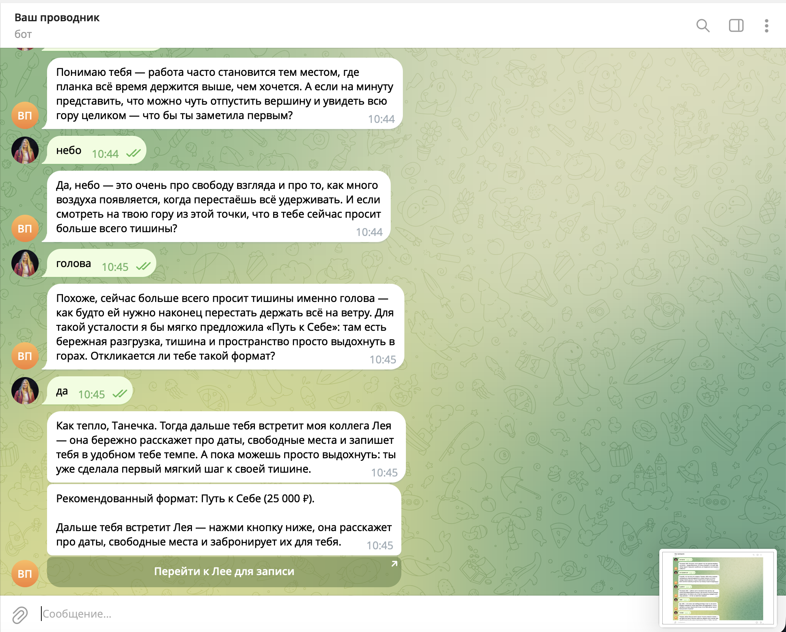
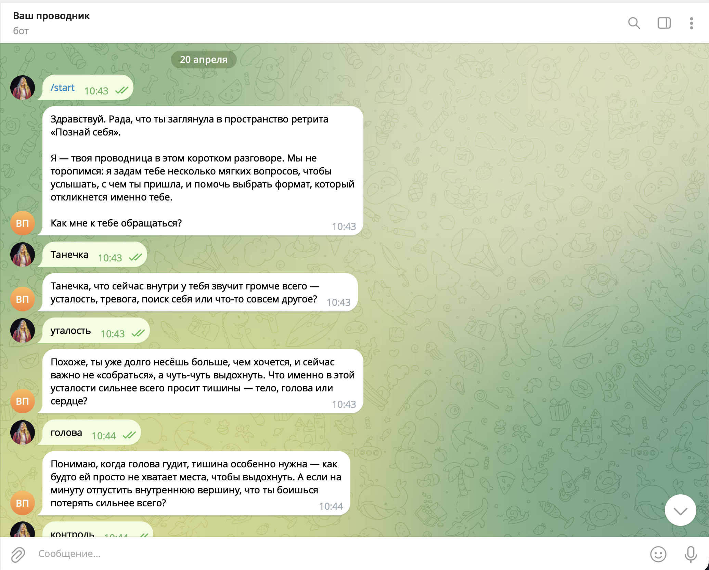

# AI-проводница ретрита «Познай себя»

Telegram-бот для женского ретрита «Познай себя». Он ведет с потенциальной участницей короткий разговор о том, с чем она пришла, подбирает один из трех форматов ретрита и передает ее боту-консультанту Лее для записи.



## О проекте

Бот отвечает за первую часть воронки, самую бережную. Он слушает, задает несколько рефлексивных вопросов и объясняет, почему участнице подойдет конкретный формат. Даты, места и оплату он не обсуждает: для этого есть Лея, отдельный бот-консультант `@retreat_poznai_bot`. Участница переходит к ней одной кнопкой в чате.

После каждого разговора в базу ложится короткая сводка. По ней организатор видит, с какими запросами приходят люди и какие форматы им откликаются.

## Задача

К ретриту приходят с очень разными запросами. Одной нужна тишина и возможность выдохнуть, другой разговор с психологом, третьей серьезная работа с коучем. Если сразу показать три цены и программу, многие теряются и уходят «подумать». А разбирать запрос каждой гостьи вручную у организатора не хватает времени.

Эмоциональный продукт плохо продается анкетой. Человеку сначала нужно, чтобы его услышали, и только потом он готов выбирать формат.

## Решение

1. **Разговор по фазам.** Знакомство и запрос, рефлексия, подбор тарифа, прощание с передачей к Лее. Реплики пишет языковая модель OpenAI по строгой инструкции, бот сам понимает, когда пора переходить дальше.
2. **Три портрета аудитории.** «Уставшая перфекционистка», «мама, которая потеряла себя», «творческий искатель». Бот определяет, к какому портрету ближе участница, и подстраивает под него язык и метафоры.
3. **Подбор формата.** Из трех тарифов («Путь к Себе», «Ритм Гармонии», «Своя Вершина») бот предлагает один и объясняет выбор словами самой участницы.
4. **Фильтр слов бренда.** Если в ответ модели проскочило «гарантированный результат» или «прорыв», бот смягчает формулировку до отправки.
5. **Остановка при тревожных сигналах.** Если участница пишет о самоповреждении или суицидальных мыслях, разговор прекращается, и бот присылает контакты психологической помощи. Ретрит терапию не заменяет.
6. **Сводка в базу.** Имя, выбранный тариф, портрет, «сигналы готовности» (спрашивала даты, говорила про оплату) и отметка о кризисном случае.

## Как это выглядит

**Начало разговора.** Бот знакомится и задает один открытый вопрос о том, с чем участница пришла.



**Рефлексивные вопросы.** По одному за раз, на каждый ответ короткий теплый отклик.


**Сводки в базе.** Основные поля разговора, затем тарифы и итоги.

| Основные поля | Тарифы и итоги |
|:-:|:-:|
|  |  |

## Результат

- Первичную квалификацию бот проводит сам: к Лее участница приходит уже с рекомендованным форматом.
- Каждый разговор оставляет обезличенную сводку, из которой видно, какие запросы и форматы встречаются чаще.
- Тексты ретрита, портреты аудитории, число вопросов, запрещенные слова и бот-партнер меняются в настройках, код при этом трогать не нужно.

Что пока не так. Тревожные сигналы бот ищет по списку слов-маркеров, поэтому завуалированную формулировку он может пропустить. Список стоит пополнять по реальным разговорам.

## Стек технологий

| Технология | Зачем используется |
|---|---|
| **Python 3.11** | Язык проекта, удобный для Telegram-ботов и работы с языковыми моделями |
| **aiogram 3** | Общение с Telegram: сообщения, кнопки «Отмена» и «Перейти к Лее», шаг разговора у каждой участницы |
| **OpenAI API** | Пишет реплики в голосе бренда по системному промпту с портретами и тарифами. Модель задается в `.env`, в `.env.example` указана `gpt-5.4-mini` |
| **httpx** | Асинхронные запросы к OpenAI: бот разговаривает с несколькими участницами одновременно |
| **PostgreSQL 16** | Хранит сводки разговоров и выдерживает параллельную нагрузку после рассылки |
| **SQLAlchemy + asyncpg** | Таблицы как классы Python и быстрый асинхронный драйвер для базы |
| **Pydantic** | Проверяет ответ модели и настройки, чтобы кривые данные не ломали разговор |
| **Docker Compose** | Поднимает бота и базу одной командой, база стартует первой |

## Структура репозитория

- `retreat_bot/bot/`: обработчики сообщений, клавиатуры, логирование.
- `retreat_bot/services/`: логика разговора и промпты для модели.
- `retreat_bot/database/`: модели таблиц и запись сводок.
- `retreat_bot/config/settings.py`: настройки и тексты бренда по умолчанию.
- `retreat_bot/schemas/`: схемы ответа модели и сессии.
- `retreat_bot/demo/`: скриншоты.

## Запуск

Нужны Docker и Docker Compose.

```bash
cd retreat_bot
cp .env.example .env
docker compose up -d --build
```

В `.env` обязательно заполнить `BOT_TOKEN`, `OPENAI_API_KEY` и `POSTGRES_PASSWORD`. Строку подключения к базе compose собирает из пароля сам, порт базы наружу не открывается. Остальные переменные (тема ретрита, число вопросов, запрещенные и тревожные слова, ник бота Леи) в примере уже заполнены, их можно поменять под свой ретрит. Тексты бренда и портреты аудитории по умолчанию берутся из `config/settings.py`, свои можно подключить файлами через `RETREAT_MATERIAL_FILE` и `AUDIENCE_PORTRAITS_FILE`.

## Автор

Татьяна Дзюбас, AI-инженер по автоматизации. Делаю Telegram-ботов, RAG-ассистентов и LLM-агентов, которые снимают рутину с небольших команд. Кейсы и контакты на [tatidzufri.com](https://tatidzufri.com).
